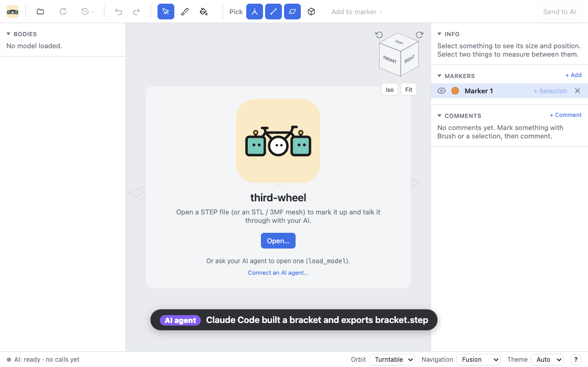

# Third Wheel: communication tool for vibe CADing

> [!NOTE]
> **Early version (v0.1).**
>
> - **Today:** Third Wheel is its own window next to your AI agent. You mark and comment on the model here and talk to
>   the AI in the agent's window (terminal, VS Code …). Claude Code and other agents that support MCP can connect.
> - **Coming next:** talking to the AI inside Third Wheel, with a chat panel next to the model and a conversation under
>   each comment, so you don't have to switch windows. No dates yet.
> - **Follow along:** star this repo, or choose **Watch → Custom → Releases** to hear about new versions. I post
>   progress videos on Instagram: [@ximple.printing](https://www.instagram.com/ximple.printing/).

Describing a CAD model to an AI in plain text takes ten minutes of "the edge on the left, no, the other one".
Third Wheel is a desktop app where you talk to your AI agent the way you'd talk to a CAD engineer: you **point at the
model**, in a second. Open a STEP file, paint or select the spot you mean, write a comment, click **Send to AI**. Your
AI agent (e.g. Claude Code) reads exactly which faces and edges you marked, changes the CAD, and the next version opens
with your notes carried over and its answers next to them.

Works with whatever makes your STEP file: a CAD app the AI controls through its scripting or MCP (Fusion, FreeCAD,
SolidWorks), or code-based CAD the AI writes (CadQuery, build123d). STL and 3MF files open too, with paint and comments
only. Runs on **macOS and Windows**. Your model file is never changed: notes are saved next to it.

## Download

Get the latest version from **[Releases](https://github.com/XiLaoTr/third-wheel/releases/latest)**:

- **Mac** (Apple Silicon and Intel, macOS 12 or newer): `Third-Wheel-<version>-mac.dmg`. Open it and drag **Third Wheel**
  into **Applications**; start it from there.
- **Windows 10 / 11**: `Third-Wheel-<version>-win-x64.exe`. Run it and follow the installer.

**The first start shows a warning — that's expected.** The app isn't signed with a paid Apple / Microsoft certificate yet,
so your computer can't tell who made it. You allow it once:

- **Mac:** "Apple could not verify “Third Wheel”…" → click **Done** (not Move to Bin). Open **System Settings → Privacy &
  Security**, scroll down to "“Third Wheel” was blocked…" and click **Open Anyway**, then **Open Anyway** again.
  (macOS 14 or older: right-click the app → **Open** → **Open**.)
- **Windows:** "Windows protected your PC" → click **More info** → **Run anyway**.

Prefer to build it yourself? [Build from source](docs/development.md#build-from-source): about 10 minutes, no programming.

## Connect Claude Code

Once: in the app, click **AI: ready** (bottom left) or **Connect an AI agent…** on the start page, then **Connect to
Claude Code**. Start a new Claude Code session, type `/mcp` (`third-wheel` should be listed) and ask, for example:

> _Make a 40 × 20 mm L-bracket with two M3 holes, export it as STEP and open it in Third Wheel for my review._

Keep the app open while the agent works. No button (Claude Code not found)? The same pop-up has a command for the
terminal and a `.mcp.json` file to copy — see the [user guide](docs/user-guide.md#connect-claude-code).

**Other agents:** Codex, Gemini CLI, Cursor, VS Code Copilot, Cline and LM Studio connect the same way: see
[Other AI agents](docs/user-guide.md#other-ai-agents) (not tested yet). The ChatGPT app / website can't (it only reaches
MCP servers on the internet); local models only through an MCP agent app like LM Studio, not Ollama alone.

## How it works

1. The AI exports a STEP file and opens it in Third Wheel.
2. You paint (**Brush**, **Smart fill**) or select faces and edges, and write comments on them.
3. **Send to AI**: the AI reads your marks as exact faces, edges and sizes — no screenshots guessing.
4. It edits the CAD and exports `part_v2.step`; your notes move to the new version, with the AI's answer under each comment.
5. You confirm or reopen. Repeat.

More: tools and shortcuts, versions, checking how two parts fit → **[User guide](docs/user-guide.md)**.
Building, tests, project layout → **[Development](docs/development.md)**.

**How it was made:** Third Wheel was designed by XiLaoTr — the idea, the user experience and the humour — and vibe-coded with
[Claude Code](https://claude.com/claude-code) (Anthropic), which wrote the code. I'm not a programmer; commits co-authored by
Claude say so in their `Co-Authored-By` line.

## License

Licensed under the [Apache License 2.0](LICENSE). Copyright 2026 XiLaoTr.
Contributions are welcome: see [Contributing](CONTRIBUTING.md) (commits need a sign-off).
